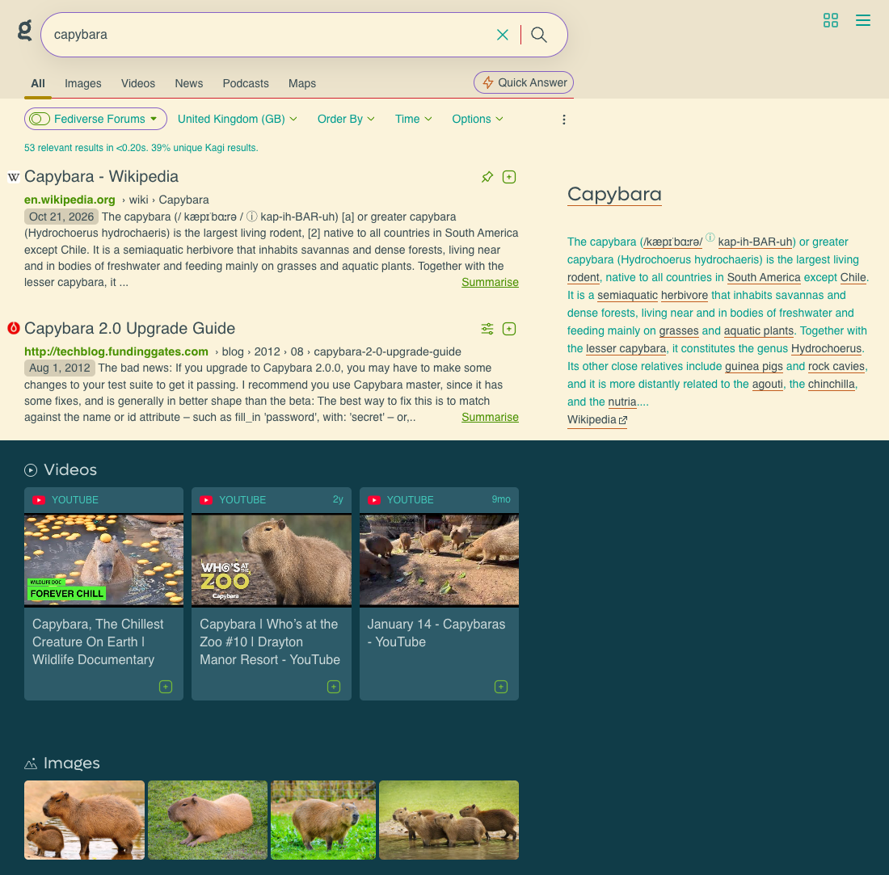
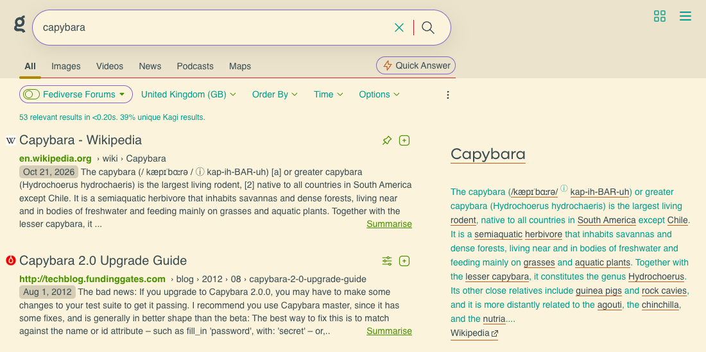
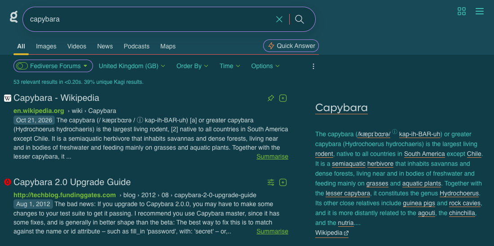

# Kagi Selenized

A [Selenized](https://github.com/jan-warchol/selenized) theme for
[Kagi](https://kagi.com) search, as a custom CSS file. It follows your
system setting: Selenized Light in light mode, Selenized Dark in dark mode.

This is an unofficial theme and is not affiliated with Kagi.

## Screenshots

The same page in both modes, light above the line and dark below it:



The video and image thumbnails belong to their respective owners.

Selenized Light:



Selenized Dark:



## Install

1. Copy the contents of [`kagi-selenized.css`](kagi-selenized.css).
1. In Kagi, open **Settings**, then **Appearance**, then **Custom CSS**, and
   choose **Change**.
1. Paste the CSS, then choose **Save Changes**.
1. Make sure **Enable Custom CSS** is on. It is in the Control Centre
   (the top-right icon on the search page).

Your existing custom CSS is replaced when you paste, so keep a copy of it
first. Kagi offers `?no_css` on a search URL if you ever need to switch the
CSS off temporarily.

## What it covers

- Search results, filters, header, side panels and the Control Centre.
- Both Selenized variants, using the canonical sRGB values.

Not covered:

- Kagi's settings pages. Kagi does not apply custom CSS there.
- Kagi Assistant. It lives on `assistant.kagi.com`, where custom CSS does
  not apply.
- Kagi can change its markup at any time, which may break individual rules.

## Colour choices

Selenized has fewer neutrals than Catppuccin, so a few choices are worth
knowing about:

- Body text uses `fg-1`, not `fg-0`. `fg-0` is only 3.8:1 on the `bg-2`
  surfaces that Kagi uses for chips and bubbles. `fg-1` gives 5.1:1 or
  better on `bg-0`, `bg-1` and `bg-2` in both variants. Text on the
  interpolated greys is lower still (`fg-1` on `grey-1` is 4.0:1 in dark).
- Four greys are interpolated between `bg-2`, `dim` and `fg-0`, to stand in
  for Catppuccin's surface and overlay shades.
- In dark mode, `bg-0` is already the darkest shade, so panels and the header
  sit one step lighter than the page instead of darker.
- Light-mode accent text, such as links, is about 3.1 to 3.6:1 on the page
  background. That comes from Selenized's accent values, which this theme
  does not alter.

A handful of Kagi's own rules produced unreadable text with this palette,
so the file ends with overrides for:

- the filter dropdown hover,
- enabled toggle switches,
- the domain preference popup (ranking bar, buttons and note).

Each is covered by a contrast test. The toggles and the popup were checked
in Kagi in both modes; the dropdown hover was only checked live in dark.

## How it is built

The CSS is generated, not hand-written. `build_theme.py` takes a Catppuccin
Kagi theme and rewrites it for Selenized:

- It replaces the palette block in each scope (light `:root`, and the two
  dark scopes) with Selenized values.
- It renames every `var(--old)` reference using a mapping table, and fails
  if a new name would collide with one already declared.
- It appends the overrides above and the licence header.

The input is `custom.css` from jcrabapple's repository:
<https://github.com/jcrabapple/kagi-catppuccin-light-dark>, at commit
`bf8f57941cf9c3c2fa4e41b2123637946bbbe66a`. The output is byte-identical
when regenerated from that commit.

The first version of this theme was converted from an earlier gist of the
same Catppuccin theme. The script still reproduces that version exactly.

To regenerate and test (needs [uv](https://docs.astral.sh/uv/) and
Python 3.13 or later):

```bash
git clone https://github.com/jcrabapple/kagi-catppuccin-light-dark.git \
  reference/github
git -C reference/github checkout bf8f57941cf9c3c2fa4e41b2123637946bbbe66a
uv run python build_theme.py reference/github/custom.css kagi-selenized.css
uv run pytest
```

`reference/` is git-ignored. The tests that run against a real input are
skipped for any that is missing. They also run against the earlier gist,
<https://repo.jcrabapple.com/jcrabapple/82208449e52b434a8e695c8124fa3f79>
(revision `1ae117e4a5bc74ff7bbbf3496eef80e4dffe312b`), if it is cloned to
`reference/gist`.

## Credits

- [Selenized](https://github.com/jan-warchol/selenized) by Jan Warchoł.
- The Catppuccin theme this was converted from, by jcrabapple (linked above).
  Neither the repository at that commit nor the earlier gist has a licence
  file or a licence mentioned in its README that I could find, so check with
  the author before redistributing anything derived from it.

## Licence

[MIT No Attribution](LICENSE). The same text is at the top of the CSS file.
